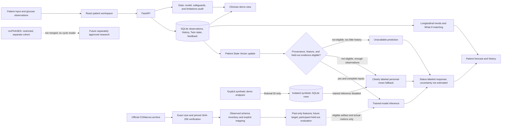

# FemMetaboTwin architecture

## Implemented user and prediction flow

No verified CGMacros archive, extracted schema, real trained artifact, or held-out metrics are present in the current submission. The trained-model branch describes guarded capability and is inactive here. The deterministic demo is a separate, fictional patient namespace and is never eligible for model inference or training. The patient/clinician role switch is a presentation control, not authentication or access control.

## Diagram export

The submission-ready [architecture PDF](architecture.pdf) is a readable one-page flow diagram. [architecture.svg](architecture.svg) is the standalone vector version. This Markdown file preserves the Mermaid source for editing. Both diagrams describe guarded capability; the trained-model branch is inactive because no real-data artifact is available.
